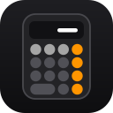

<div align="center">
  
  <h1>Calculator (iOS Style for Android)</h1>
  <p>
    以 Jetpack Compose 高度還原 <strong>iOS 27 ~ iOS 12</strong> 原廠視覺、手勢互動與 iPadOS 平板排版體驗的現代 Android 計算機。<br />
    <em>A Jetpack Compose Android calculator recreating authentic iOS 27 ~ iOS 12 UI generations, gestures, and iPadOS tablet layouts.</em>
  </p>
  <p>
    <a href="README.md"><strong>繁體中文</strong></a> &nbsp;|&nbsp;
    <a href="README_zh-CN.md">简体中文</a> &nbsp;|&nbsp;
    <a href="README_en.md">English</a> &nbsp;|&nbsp;
    <a href="https://github.com/Dogfish0528/IosCalculatorApp/releases">下載 APK / Releases</a>
  </p>
</div>

---

## 簡介 (Introduction · 繁體中文)

**Calculator** 是一款專為 Android 手機與平板打造的 iOS 風格計算機應用程式。不同於一般僅模仿單一配色的仿製軟體，本專案參照 **Apple 官方支援頁面 (`iOS 27 ~ iOS 12`)** 的演進細節，將「頂部歷程與模式圖示」、「按鍵排列 (`⌫/AC` 與雙倍寬 `0` 鍵)」、「Liquid Glass 液態玻璃微光邊框」及「iPadOS 橫向全寬與左側滑出歷程側邊欄」完整重現於 Android 平台。

> 下載安裝：**繁體中文顯示「計算機」**、**简体中文显示「计算器」**、**英文顯示「Calculator」**，桌面採用專屬深色高質感計算機圖示。

### 主要特色

- **9 大 iOS 官方世代樣式 (`iOS 27 ~ iOS 12`)**
  - **iOS 27**：頂部時鐘歷程鈕＋實心計算機切換鈕、沉穩深橘 `#F08800`、`⌫ AC % ÷` 與清晰放大版 `+/-` 圖示（首次啟動預設推薦「最新（iOS 最新主題）」）。
  - **iOS 26**：Liquid Glass 液態玻璃微光邊框、圓框 `list.bullet` 歷程鈕＋線框計算機圖示。
  - **iOS 18**：左上無框橘色 `list.bullet` 清單、左下角實心計算機切換鍵（右上角永遠隱藏）、動態 `AC / ⌫` 切換。
  - **iOS 17 ~ iOS 12**：經典單行數值顯示、淺銀灰黑字功能鍵、雙倍寬 `0` 鍵、運算鍵白底橘字反白高亮與滑動螢幕退格；頂部統一顯示清晰的 iOS 27 圖示。
- **首次安裝版本選擇引導**
  - 首次開啟會自動彈出版本選擇畫面（預設選取 **iOS 27 最新主題**），附即時動態縮圖預覽與一鍵切換語言。
- **智慧橫直向與平板 (`iPadOS`) 滿寬適配**
  - **手機橫向**：可設定自動切換為 `5 × 10` 並排科學計算機，轉回直向自動恢復基本模式。
  - **平板／大螢幕**：iPadOS 風格滿寬拉長計算機版面；展開歷程記錄時會從左側滑出約佔螢幕 **1/5 寬度** 的側邊欄，即使在科學計算機下也能同步檢視與回填算式。
- **高度自由的自訂系統（設定 › 編輯）**
  - **基底主題**：版本預設 / 純黑 OLED / 曜石深灰 / 午夜深藍 / 淺色白晝（設定頁、預覽卡與所有彈出面板全面同步變色）。
  - **外觀混搭**：8 種運算鍵強調色、按鍵排列獨立覆寫 (`iOS 27` / `iOS 18` / `經典`)、按鍵圓角形狀與縫隙密度、Liquid Glass 邊框開關、數字字重／比例與按鍵圖示文字縮放、上方算式過程列開關、點擊震動與音效回饋。
- **單位轉換與三語系自動適配**
  - 內建長度／重量／面積／溫度／資料即時單位轉換面板。
  - 完整支援 **繁體中文**、**简体中文**、**English** 與 **跟隨系統** 語系自動切換。

### 下載與安裝

1. 前往 [Releases 頁面](https://github.com/Dogfish0528/IosCalculatorApp/releases) 下載最新版本的 `.apk`（例如 `IosCalculatorApp-v1.0.0.apk`）。
2. 在 Android 手機或平板（`Android 8.0 / API 26` 以上）開啟安裝即可。

### 本機建置與測試

```bash
# 執行單元測試並建置 Debug APK
./gradlew testDebugUnitTest assembleDebug
```

---

## 快速切換其他語言說明

- 📖 **[简体中文完整说明 (README_zh-CN.md)](README_zh-CN.md)** — 了解如何在简体中文环境下使用「计算器」、iOS 27~12 主题特色、平板侧边栏与自定义功能。
- 📖 **[English Documentation (README_en.md)](README_en.md)** — Full English introduction, features, installation guide, and technical stack for **Calculator**.

---

## 專案檔案結構

```text
app/src/main/
├── java/com/example/ioscalculatorapp/
│   ├── MainActivity.kt        # CalculatorEngine 解析核心、平板／手機響應式計算機介面、左側／底部歷程面板
│   ├── IosStyleSettings.kt    # iOS 27~12 主題引擎、滿寬雙欄設定頁、首次版本選擇引導、多語系翻譯核心
│   └── UnitConverterBar.kt    # 即時多語系單位轉換面板
└── res/
    ├── drawable/              # 自訂 SVG 計算機應用圖示與各代 iOS 原廠向量按鍵圖示
    ├── mipmap-anydpi/         # Adaptive Launcher Icon 設定
    └── values* /strings.xml   # 英文 (Calculator)、簡體 (计算器)、繁體 (計算機) 應用名稱
```

## 免責聲明

本專案僅供 Android Jetpack Compose UI/UX 開發學習與作品展示之用，與 Apple Inc. 無任何關聯。
