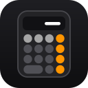

<div align="center">
  
  <h1>Calculator (iOS Style for Android)</h1>
  <p>
    A faithful, customizable Android & Tablet calculator built with Jetpack Compose, recreating <strong>iOS 27 ~ iOS 12</strong> generations, icons, gestures, and iPadOS layouts.
  </p>
  <p>
    <a href="README.md">繁體中文</a> &nbsp;|&nbsp;
    <a href="README_zh-CN.md">简体中文</a> &nbsp;|&nbsp;
    <a href="README_en.md"><strong>English</strong></a> &nbsp;|&nbsp;
    <a href="https://github.com/Dogfish0528/IosCalculatorApp/releases">Download APK / Releases</a>
  </p>
</div>

---

## Overview

**Calculator (IosCalculatorApp)** brings authentic Apple calculator experiences from **iOS 12 all the way through iOS 27** to Android phones and tablets. Instead of copying only a single color palette, every UI generation mirrors the corresponding Apple Support guide details—from classic double-width zero and swipe-to-delete gestures to iOS 18's bottom-left mode switcher, iOS 26's Liquid Glass borders, and iOS 27's enlarged controls.

> Localized launcher app name: **Calculator** on English devices, **计算器** on Simplified Chinese devices, and **計算機** on Traditional Chinese devices, paired with a custom dark adaptive calculator launcher icon.

### Key Features

- **9 Official iOS Generations (`iOS 27 ~ iOS 12`)**
  - **iOS 27** *(Recommended Default on First Launch)*: Clock & solid calculator top buttons, `⌫ AC % ÷`, bottom `+/- 0 . =` with an enlarged crisp `+/-` glyph, and deep orange `#F08800`.
  - **iOS 26**: Liquid Glass luminous button borders, circular `list.bullet` history button, and outlined wireframe calculator icon.
  - **iOS 18**: Frameless orange `list.bullet` top-left button, dedicated bottom-left mode switcher (with no top-right icon), and dynamic `AC / ⌫` toggle.
  - **iOS 17 ~ iOS 12**: Classic single-line numeric display, light-silver top function keys, double-width `0`, white active-operator highlight, swipe-to-backspace across the display, and unified top-bar controls.
- **First-Launch iOS Version Picker**
  - On first install, an onboarding screen invites you to pick your favorite iOS style (pre-selecting **iOS 27 (Latest Theme)**) with a live mini preview and instant language switcher.
- **Smart Orientation & iPadOS Tablet Layout**
  - **Phone Landscape**: Automatically switches to a `5 × 10` side-by-side Scientific Calculator (configurable in Settings) and returns to Basic in portrait.
  - **Tablet / Wide Screens**: Full-width iPadOS adaptive layout with a **left slide-out History sidebar (~1/5 screen width)** that works seamlessly alongside both Basic and Scientific modes.
- **Deep Visual & Interaction Customization (`Settings › Edit`)**
  - **Base Background Themes**: Version Default, OLED Black, Charcoal, Midnight Blue, and **Light Mode** (adapts Settings, mini preview, menus, and History panels together).
  - **Mix & Match**: 8 operator accent colors, independent keypad layout override (`iOS 27` / `iOS 18` / `Classic`), button shapes & spacing, Liquid Glass borders toggle, display/key typography & icon scaling, top expression line visibility, key click sound, and haptic feedback.
- **Built-in Unit Converter & Trilingual Support**
  - Live conversion for Length, Weight, Area, Temperature, and Data.
  - Full UI support for **English**, **简体中文**, **繁體中文**, and **System Auto**.

### Download & Install

1. Go to the [Releases page](https://github.com/Dogfish0528/IosCalculatorApp/releases) and download `IosCalculatorApp-v1.0.0.apk`.
2. Install on any Android phone or tablet running **Android 8.0 (API 26)** or higher.

### Build & Run Tests Locally

```bash
./gradlew testDebugUnitTest assembleDebug
```

## Disclaimer

This project is an independent Jetpack Compose UI/UX engineering showcase for educational and personal portfolio purposes and is not affiliated with or endorsed by Apple Inc.
