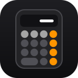

<div align="center">
  
  <h1>计算器 (iOS Style for Android)</h1>
  <p>
    使用 Jetpack Compose 深度还原 <strong>iOS 27 ~ iOS 12</strong> 原厂视觉、手势交互与 iPadOS 平板排版体验的现代 Android 计算器。
  </p>
  <p>
    <a href="README.md">繁體中文</a> &nbsp;|&nbsp;
    <a href="README_zh-CN.md"><strong>简体中文</strong></a> &nbsp;|&nbsp;
    <a href="README_en.md">English</a> &nbsp;|&nbsp;
    <a href="https://github.com/Dogfish0528/IosCalculatorApp/releases">下载 APK / Releases</a>
  </p>
</div>

---

## 项目介绍

**计算器 (IosCalculatorApp)** 是一款专为 Android 手机与平板打造的苹果 iOS 风格计算器应用。本项目严格参照 **Apple 官方支持页面 (`iOS 27 ~ iOS 12`)** 的历代设计细节，在桌面图标、顶栏按钮、按键排布、Liquid Glass 液态玻璃边框以及 iPadOS 宽屏交互上做到高度一致。

> 安装后，在简体中文系统桌面显示名称为 **「计算器」**（繁体中文显示「計算機」，英文系统显示 `Calculator`），并采用定制深色高质感计算器图标。

### 核心功能

- **完整还原 9 个 iOS 官方版本 (`iOS 27 ~ iOS 12`)**
  - **iOS 27**：顶部时钟历史按钮＋实心计算器切换按钮、沉稳深橙 `#F08800`、`⌫ AC % ÷` 与清晰放大的 `+/-` 图标（首次启动默认推荐「最新（iOS 最新主题）」）。
  - **iOS 26**：Liquid Glass 液态玻璃微光边框、圆框 `list.bullet` 历史按钮＋线框计算器图标。
  - **iOS 18**：左上无框橙色 `list.bullet` 列表、左下角实心计算器切换键（右上角不显示图标）、动态 `AC / ⌫` 切换。
  - **iOS 17 ~ iOS 12**：经典单行显示、浅银灰黑字功能键、双倍宽 `0` 键、运算符白底橙字高亮反白与左右滑动屏幕退格；顶部统一补充清晰的 iOS 27 图标方便切换模式与设置。
- **首次安装引导选择器**
  - 首次打开 App 会弹出版本选择界面（默认预选 **iOS 27 最新主题**），顶部配有实时动态缩略图预览，右上角支持一键切换简体中文／繁体中文／English。
- **手机横屏自动科学模式 & iPadOS 平板适配**
  - **手机横屏**：默认自动切换为 `5 × 10` 并排科学计算器（可在设置中关闭或开启），转回竖屏自动回到基本模式。
  - **平板／大屏**：iPadOS 风格全宽自适应布局；点击历史记录时会从屏幕 **左侧滑出约占 1/5 宽度** 的常驻侧边栏，即使在科学计算器模式下也能一边计算一边查看并回填历史算式。
- **丰富自定义设置（设置 › 编辑）**
  - **背景主题**：版本默认 / 纯黑 OLED / 曜石深灰 / 午夜深蓝 / 浅色白昼（设置页面、预览卡、菜单与历史记录面板同步全面变色）。
  - **自由混搭**：8 种运算键强调色、按键排列独立切换 (`iOS 27` / `iOS 18` / `经典双倍 0`)、按键圆角形状与间距密度、液态玻璃微光边框开关、数字字重与比例缩放、按键文字图标缩放、顶部算式过程行开关、触感震动与按键音效反馈。
- **实时单位转换 & 三语支持**
  - 内置长度、重量、面积、温度与数据单位实时换算面板。
  - 支持 **简体中文**、**繁體中文**、**English** 以及 **跟随系统** 自动切换。

### 下载与安装

1. 前往 [Releases 页面](https://github.com/Dogfish0528/IosCalculatorApp/releases) 下载最新安装包（如 `IosCalculatorApp-v1.0.0.apk`）。
2. 在 Android 8.0 (API 26) 及以上手机或平板设备上直接安装即可使用。

### 本地编译与单元测试

```bash
./gradlew testDebugUnitTest assembleDebug
```

## 免责声明

本项目仅用于 Android Jetpack Compose UI/UX 开发学习与作品展示，与 Apple Inc. 没有任何关联。
